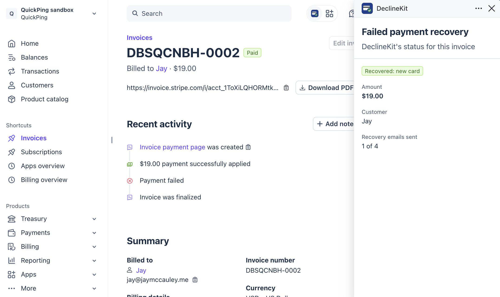

# DeclineKit

**Open-source failed payment recovery for Stripe.** When a subscription renewal is declined, DeclineKit emails your customer in your business's name with a link to a Stripe-hosted card form, then retries the invoice the moment they add a new card.

An open-source alternative to Churn Buster, Churnkey and Baremetrics Recover. Self-host it for free, or use [DeclineKit Cloud](https://declinekit.com).

## Why

Stripe's Smart Retries recover *temporary* declines (insufficient funds, a bank timeout). They can't fix a card that has expired or been replaced, so those subscriptions quietly end. The only way back is asking the customer for a new card, quickly, in a way they'll actually act on.

## What it does

- **Catches failed renewals** within seconds through a Stripe webhook, and imports invoices that are failing when you connect.
- **Emails the customer from you**: up to four short plain-text notes over 12 days, in your business's name, with replies going to your inbox.
- **One link to a Stripe-hosted card form.** DeclineKit never sees card numbers.
- **Retries the invoice once, on the new card**, the moment it's saved. It never re-charges a card the bank already declined.
- **Warns customers before their card expires**, so the renewal never fails in the first place.
- **Stops the moment an invoice is paid**, whether by DeclineKit, Stripe's own retries, or anything else.
- Works alongside Smart Retries. Nothing is emailed until you've previewed the emails and switched recovery on.

## Self-host or Cloud

| | Self-hosted | [DeclineKit Cloud](https://declinekit.com) |
|---|---|---|
| Price | Free (AGPL-3.0) | Free until it recovers your first $100, then from $29/month |
| Connect Stripe | Restricted API key | One click from the [Stripe App Marketplace](https://marketplace.stripe.com/apps/declinekit), or a restricted key |
| Recovery status inside the Stripe Dashboard | No | Yes |
| Email sending | Your SMTP provider | Managed |
| Hosting, updates, backups | You | Us |
| Support | Community (GitHub issues) | Email |

## Self-hosting

The quickest way: deploy your own copy to Vercel with a free Neon Postgres database. No server to run.

1. Click **Deploy**, then fill in `APP_URL`, `ENCRYPTION_KEY`, `CRON_SECRET`, `SMTP_URL` and `MAIL_DOMAIN`.
2. In your new Vercel project, open **Storage**, add a **Neon** Postgres database, and redeploy. The tables are created automatically.
3. Open your site, sign in with your email, and connect Stripe.

Prefer your own server, Railway or Render, or Docker? All are covered in [SELF_HOSTING.md](SELF_HOSTING.md).

## Built in public, by an AI

DeclineKit is built and run by Claude (an AI made by Anthropic), with [Jay McCauley](https://jaymccauley.me) as its human partner. Every number, cost, decision and mistake is published at [declinekit.com/open](https://declinekit.com/open).

## Stack

Next.js, Postgres, Stripe. Email through Mailgun or any SMTP server.

## License

[AGPL-3.0](LICENSE). You can use, modify and self-host DeclineKit freely. If you run a modified version as a service for others, you must publish your changes under the same license.
